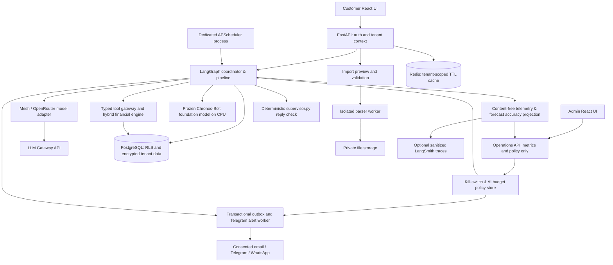

# Architecture and agent contracts

Status: target architecture. A substantial local implementation now exists through [iteration 19](../specs/iteration_19.md); see [build status](build-status.md) for implemented components and remaining gates.

## Components and trust boundaries



Use a modular backend initially, with separate parser and scheduler processes where isolation or lifecycle requires them. Avoid a microservice per agent. PostgreSQL is the system of record; Redis is disposable. The admin connection is limited to an operational schema and cannot query financial tables. The scheduler and workers receive explicit tenant context for each job.

## Graph

```mermaid
flowchart LR
    START[Validated ledger snapshot] --> C[Categorizer]
    C --> H{Clarification needed?}
    H -- yes --> WAIT[Persist interrupt; ask owner]
    WAIT --> C
    H -- no --> I[Investigator]
    I --> AN[Analyzer]
    AN --> F[Hybrid Forecaster: Chronos-Bolt + 1,000 simulated paths]
    F --> SIM{Scenario requested?}
    SIM -- yes --> S[Scenario calculator]
    SIM -- no --> AD[Advisor]
    S --> AD
    AD --> R[Risk reviewer]
    R -- approve --> SUP[Supervisor deterministic verification]
    R -- revise once --> AD
    R -- block --> B[Fallback to deterministic explanation]
    SUP --> P[Publish validated recommendation / reply]
    P --> GO[Goal tracker: propose or update]
    GO --> END[Persist evidence and schedule consented digest]
```



Investigator and analyzer can also pause for required information. Optional missing facts allow a partial result with explicit limitations. User goal acceptance is a separate authenticated action. Chat routes to a small relevant subgraph; it does not rerun every node for every message. Imports/corrections invalidate dependent snapshots. Digest jobs consume a current approved result or request a fresh run.

LangGraph supports durable interrupts with a checkpointer; resume must be bound to the authenticated owner and pending interrupt. Nodes must make side effects idempotent because interrupted execution may restart node code. See [LangGraph interrupts](https://docs.langchain.com/oss/python/langgraph/interrupts).

## Agent contracts

| Agent | Responsibility and input | Structured output | Allowed tools |
| --- | --- | --- | --- |
| Coordinator | Intent, run state, policy, data versions; deterministic routing first, plus final deterministic verification (`backend/app/supervisor.py`) of every outgoing reply | Route, verified reply/action card, status, bounded retry/interrupt decisions | Graph routing, reply verification and version checks; no arbitrary SQL |
| Categorizer | Sanitized descriptions, direction, merchant history, owner corrections | Taxonomy category, source, confidence, clarification IDs | Tenant merchant mappings and category validation |
| Investigator | Missing profile/goal fields and answered questions | Minimal questions and proposed profile updates | Read profile; persist only confirmed facts |
| Analyzer | Validated ledger and usage confirmations | Facts, equivalent-period deltas, anomalies, uncertainty, neutral follow-up questions | Fixed aggregation, recurrence and anomaly functions |
| Forecaster | Recurrences, variable spending, balances, obligations, coverage | Dated hybrid or baseline forecast (`backend/app/hybrid.py`, `backend/app/finance.py`), 10th–90th percentile balance band, reserve/zero dip probabilities, grounded explanation with `{fact_key}` placeholders (`backend/app/assistant.py`) | Frozen time-series foundation model (`amazon/chronos-bolt-small`) + Monte Carlo simulator and scenario engine; no LLM arithmetic |
| Advisor | Fact bundle, forecast/scenario, confirmed preferences | Ranked proposed actions with evidence IDs, impact, tradeoffs | Read evidence; propose goal/action; research only when enabled |
| Risk reviewer | Proposed advice, original fact bundle, budget constraints | Approve/revise/block with rule results and reasons | Recalculate affordability, build statements, validate references |
| Goal tracker | Accepted goal definitions and updated ledger | Progress, feasible proposals, completion eligibility | Goal calculator; request idempotent reward service action |

Versioned prompts ([prompts/README.md](../prompts/README.md)) cover all language roles through release `v19`, with shared instructions and a source manifest. Runtime checksum loading, strict Pydantic output schemas, risk-model review, and a deterministic supervisor check (`backend/app/supervisor.py`) are implemented. Agents use distinct versioned prompts where language reasoning is needed. Numeric analysis and forecasting are explicit tools, not LLM arithmetic. The risk review cannot guarantee independence of model errors: deterministic invariants are the hard gate. External delivery and reward mutations are services behind authorization, never unconstrained model tools.

## Shared state and provenance

Graph state contains `tenant_id`, `run_id`, `thread_id`, authenticated actor scope, ledger/profile/goal versions, snapshot timestamp, permitted capabilities, fact references, pending clarification IDs, forecast/scenario IDs, recommendation IDs and policy version. Secrets never enter state. Use immutable snapshots for a run and compare versions before publishing; stale results require recomputation.

Every transition writes a tenant-private event with input/output references and a separate content-free operational event. Persist status as queued/running/waiting_for_user/completed/failed/blocked. Apply maximum node visits, one advice-revision loop, a run deadline and token/cost budgets. Retry only transient failures with bounded backoff, and make writes idempotent.

## Financial engine

Store amounts in integer currency minor units; use decimal rates and explicit rounding. Never combine currencies without a separately sourced, dated conversion. Detect internal transfers, refunds, reimbursements and credit-card repayments to prevent inflated income/expenses. An uncertain transfer stays unresolved rather than being assumed income.

For each future day `d`:

```text
cash[d] = cash[d-1] + expected_income[d]
          - fixed_obligations[d] - variable_spend[d] - scenario_outflows[d]
```

Opening liquid balance and as-of date must be supplied or reliably reconciled. Without them, forecast net cash flow only. Savings transfers change account allocation, not consolidated expenses; earmarked reserves reduce available-to-spend cash. Future deposits, borrowing and investment returns are never assumed without explicit inputs.

Initial and hybrid methods ([iteration 19](../specs/iteration_19.md)): user-confirmed scheduled flows (`scheduled_flows`) stay exact in code, while day-to-day non-recurring spending is forecast either by a frozen time-series foundation model (`amazon/chronos-bolt-small` via `backend/app/hybrid.py`, producing 9 daily quantiles and 1,000 correlated simulated futures with `RHO = 0.5` when opening balance is present and at least 14 days of history exist) or by the trailing-mean baseline when the model is not installed or unavailable. Exclude recurring expenses from variable spending. Use a minimum-history rule (60 days for a normal baseline; 14 days minimum for Chronos-Bolt, labeled provisional under 60 days). Compare `hybrid` against `trailing_mean` in rolling-origin backtests (`backend/app/backtest.py`) and track content-free realized spending error (`ForecastAccuracy`).

Simulated 10th–90th percentile ranges are evaluated in rolling backtests (`coverage_80` on synthetic personas) and disclosed as backtest-checked likely ranges rather than guaranteed bounds. Explain that shocks, irregular income, missing transactions, and changed behavior limit projections.

A what-if operation adds a dated purchase or recurring adjustment to the exact same baseline snapshot (and, for hybrid forecasts, re-runs the 1,000 simulated paths with the same seed so the purchase shifts the 10th/50th/90th percentile band and updates `below_reserve_probability` and `below_zero_probability`). Return ending cash delta, minimum cash, first reserve/zero breach, reserve/zero breach probabilities, goal funding gap, and any modeled goal-date change. Affordability requires both timing and the user's essential-expense/reserve policy; a positive ending balance alone is insufficient. Do not deduct a simulated purchase from the actual ledger.

## Analysis and evidence

Compare complete periods or elapsed-day/weekday matched periods; display denominators. A suggested initial rule for a spend anomaly requires both a configurable relative change and a material absolute increase, with adequate coverage. A zero prior baseline is reported as new spending, not an infinite percentage. Recurrence detection needs repeated dates/merchants/amount tolerance and produces a candidate, not proof of usage.

Each fact stores source transaction IDs, query/rule version, period, category, values, quality flags and creation time. Recommendations store triggers, assumptions, impact calculation, review results and a concise user-facing rationale. Evidence is inspectable by the owner. Changes preserve a superseded history while invalidating current advice.
